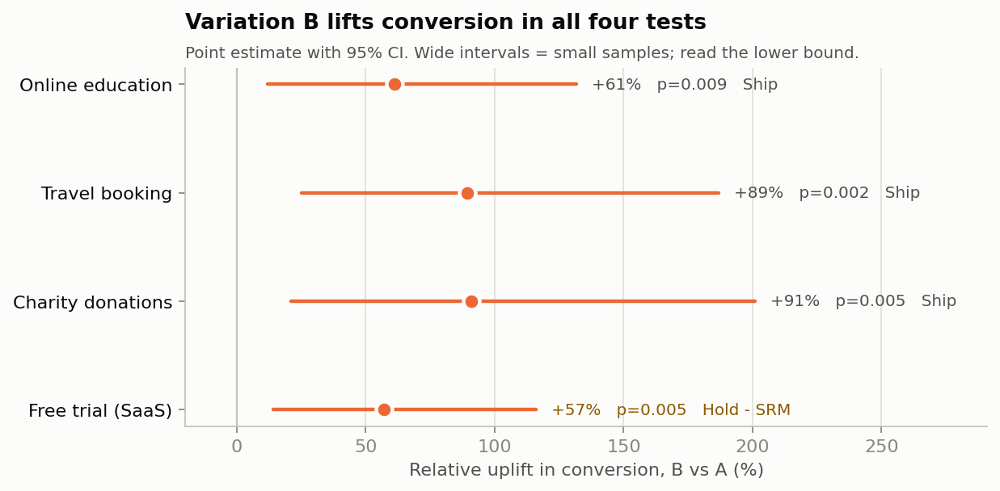
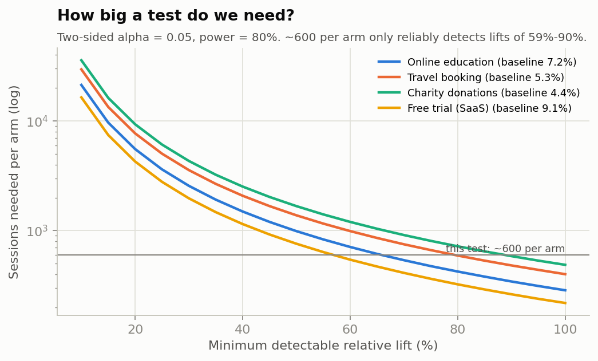
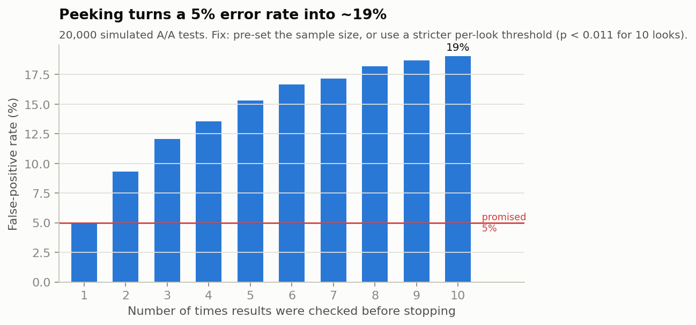

# A/B Test Analyzer: four experiments, one trustworthy pipeline

`abkit` is a Python toolkit that takes raw A/B test sessions and returns a decision you can defend: ship, hold, extend or reject. Before it reports an uplift, it checks whether the experiment itself can be trusted. Then it reads the result in both frequentist and Bayesian terms, tests guardrails, checks whether the test was big enough, corrects segment analysis for multiple testing, and fits an uplift model to see whether personalisation is worth it.

I ran it on four website experiments (online education, travel booking, charity donations, SaaS free trial). Variation B "won" all four on the headline numbers. The pipeline recommends shipping three of them, holds the fourth because its traffic split is off, and flags caveats a dashboard would hide.



## Results at a glance

| Experiment | Control | Variation | Uplift (95% CI) | p | P(B>A) | Decision |
|---|---|---|---|---|---|---|
| Online education: course enrolment | 7.2% | 11.5% | +61% (+12% to +132%) | 0.009 | 99.6% | Ship, phased |
| Travel booking: hotel reservations | 5.3% | 10.0% | +89% (+25% to +187%) | 0.002 | 99.9% | Ship, phased |
| Charity: online donations | 4.4% | 8.4% | +91% (+21% to +201%) | 0.005 | 99.8% | Ship, but don't promise revenue |
| SaaS: free-trial sign-up | 9.1% | 14.3% | +57% (+14% to +116%) | 0.005 | 99.7% | **Hold: traffic split is off** |

Full numbers for every scenario are in [`reports/summary.md`](reports/summary.md) and [`reports/results.json`](reports/results.json).

## What the pipeline caught

**1. A broken traffic split behind a "winning" test (free trial).** The test was meant to split visitors 50/50, but control got 639 sessions and the variation got 561. A sample ratio mismatch test puts the odds of that happening by chance at about 2.4%. SRM usually means something in the pipeline is dropping users from one arm (a redirect that fails on some browsers, bot filtering that treats the arms differently, an assignment bug). Those losses are rarely random, so the +57% can't be trusted until the cause is found. The pipeline holds the rollout even though p = 0.005.

**2. The tests were too small to measure the effect precisely.** About 600 sessions per arm could only reliably detect lifts of +59% to +90% at 80% power. A realistic UI change lifts conversion by 5–20%, and detecting a 20% lift would need 4,300–9,300 sessions per arm. When an underpowered test does come out significant, it overstates the effect: a simulation shows that if the true lift were 20%, the significant results these tests produce would overshoot it 2.9–4.8x on average (the "winner's curse", Gelman & Carlin, 2014). The +89% for travel booking is real evidence that B is better, but a business case should be built on the lower end of the interval.



**3. More conversions isn't always more money.** In the charity test, donations rose 91%, but the average gift fell from $97 to $87, and the bootstrap interval for revenue per visitor crosses zero. Travel shows the same pattern: B gets more bookings, but the average booking value dipped 11% (not significant). Revenue still rose 69% there because the conversion gain was big enough.

**4. Segment "findings" mostly disappear after correction.** Each test was sliced 9 ways (device, user type, page). With that many cuts, chance alone will produce a "significant" segment fairly often. After Holm correction only two segments survive across all four tests. The one worth following up: in online education, B worked on mobile (+8.1 pp, Holm p = 0.015) and did nothing on desktop (−0.6 pp), with a device × treatment interaction of p = 0.044. That is a hypothesis for the next test, not grounds to personalise yet.

**5. The uplift model found nothing to target, and that's useful.** A cross-fitted T-learner ranked visitors by predicted benefit from B. In all four tests its Qini curve did no better than random ordering (permutation p = 0.21–0.55). So the evidence supports rolling B out to everyone rather than building personalisation.

**6. Peeking would have inflated false positives to about 19%.** A simulation of 20,000 A/A tests shows that checking results 10 times and stopping at the first p < 0.05 produces a false positive 19% of the time instead of 5%. The pipeline reports the stricter per-look threshold (p < 0.011) that keeps the overall rate at 5%.



## What's inside

| Stage | Method | Module |
|---|---|---|
| Trust checks | SRM chi-square (warn p < 0.05, fail p < 0.001), duplicates, nulls, revenue/conversion and bounce/conversion consistency, bot-like timings, covariate balance (SMD) | `quality.py` |
| Primary KPI | Pooled two-proportion z-test, Wald CI for the difference, delta-method CI for relative uplift, Fisher exact test, Cohen's h | `stats.py` |
| Secondary KPIs | Welch t-test (time on page, order value), percentile bootstrap for revenue per visitor | `stats.py` |
| Guardrail | One-sided non-inferiority test on bounce rate (margin +2 pp) | `stats.py` |
| Robustness | Logistic regression adjusted for device and user type | `stats.py` |
| Bayesian view | Beta-Binomial posteriors, P(B > A), expected loss | `bayes.py` |
| Planning | Sample size, MDE, runtime, winner's-curse simulation, peeking simulation with calibrated boundary | `power.py` |
| Segments | Per-segment Fisher tests with Holm and Benjamini–Hochberg correction, likelihood-ratio interaction tests | `segments.py` |
| Uplift model | T-learner (L2 logistic regression), 5-fold cross-fitting, Qini curve with permutation baseline | `uplift.py` |
| Decision | Ordered rules: trust → guardrails → primary KPI, plus automatic caveats | `decision.py` |

### A design choice worth explaining

The datasets record which page each session was on (`PageViewed`). It is tempting to control for it or feed it to the uplift model, but the variation can change which page people reach. In the travel test, B has far fewer sessions recorded on the payment page (74 vs 120, p = 0.009). Adjusting for a variable the treatment affects biases the estimate, so `PageViewed` is used only for exploratory charts. Adjustment and uplift modelling use only attributes fixed before assignment (device and user type).

## Interactive dashboard

```bash
streamlit run app/streamlit_app.py
```

Pick a scenario, or upload your own CSV with the same columns. The app shows the decision and caveats up top, then tabs for trust checks, results, segments, the uplift model and a test planner. The planner has a live sample-size calculator and a peeking simulator. Significance level, guardrail margin and traffic assumptions are adjustable in the sidebar.

## Quick start

```bash
git clone https://github.com/CyrusNamjoo/ab-testing-toolkit.git
cd ab-testing-toolkit
python -m venv .venv && source .venv/bin/activate   # Windows: .venv\Scripts\activate
pip install -r requirements.txt

python scripts/run_analysis.py      # regenerates reports/ and figures
pytest                              # 18 tests
streamlit run app/streamlit_app.py  # dashboard
```

Use it as a library:

```python
from abkit import analyze

res = analyze("travel_booking")
print(res["decision"]["label"])        # Ship B - phased rollout
print(res["primary"]["uplift_ci"])     # ~(0.25, 1.87)
print(res["bayes"]["prob_b_better"])   # ~0.999
```

To add a new experiment, add one entry to `src/abkit/scenarios.py` and drop the file in `data/raw/`.

## Repository layout

```
├── app/streamlit_app.py          interactive dashboard
├── data/raw/                     four A/B datasets (1,200 sessions each)
├── notebooks/
│   └── 01_travel_booking_case_study.ipynb   end-to-end walkthrough
├── reports/
│   ├── figures/                  all charts (regenerated by the script)
│   ├── results.json              every number, machine-readable
│   └── summary.md                per-scenario write-up
├── scripts/run_analysis.py       CLI: runs everything
├── src/abkit/                    the toolkit
└── tests/                        unit tests checked against statsmodels/scipy
```

## Recommendations (travel booking)

1. Roll out in phases (25% → 50% → 100% over three weeks), with automatic rollback if bounce rate rises more than 2 pp or checkout errors increase.
2. Size the business case on the lower confidence bound (+25%), not the +89% headline.
3. Track revenue per visitor and booking value mix, not just conversion count.
4. Keep a 5% holdout and check at 4–6 weeks that conversion is still at least 1 pp above baseline with no guardrail degradation.
5. Next test: split the two changes (transparent pricing vs one-page checkout) to learn which one drives the lift.

## Ethics and privacy

The analysis works on session-level data with no personal identifiers. Running similar tests in production would need disclosure of experimentation in the privacy policy (Australian Privacy Principles 1 and 5), consent-gated analytics cookies, and no dark patterns in variations (hidden fees, pre-ticked boxes, false urgency). Price-display tests in particular need to comply with the Australian Consumer Law on drip pricing. Segment-level personalisation should not use protected attributes or proxies for them.

## Limitations

- The data is simulated coursework data (MIS5308 Social and Web Analytics, Apex Higher Education). The datasets record which arm each session saw, not what B actually changed, so the variations described in `scenarios.py` are hypothesised.
- Sessions are treated as independent. Real traffic has repeat visitors, so a production version should randomise and analyse at the user level.
- There is no timestamp, so novelty effects, day-of-week patterns and sequential monitoring can't be checked on the real data. Peeking is shown by simulation instead.
- Business impact figures use an assumed 30,000 sessions per month for illustration.

## References

- Gelman, A., & Carlin, J. (2014). Beyond power calculations: Assessing Type S (sign) and Type M (magnitude) errors. *Perspectives on Psychological Science, 9*(6), 641–651.
- Kohavi, R., Tang, D., & Xu, Y. (2020). *Trustworthy online controlled experiments: A practical guide to A/B testing*. Cambridge University Press.
- Künzel, S. R., Sekhon, J. S., Bickel, P. J., & Yu, B. (2019). Metalearners for estimating heterogeneous treatment effects using machine learning. *PNAS, 116*(10), 4156–4165.
- Radcliffe, N. J. (2007). Using control groups to target on predicted lift: Building and assessing uplift models. *Direct Marketing Analytics Journal, 1*, 14–21.

## License

MIT. Built by Cyrus (Sirous) Namjoo, Master of Information Systems (Data Analytics), Apex Higher Education.
