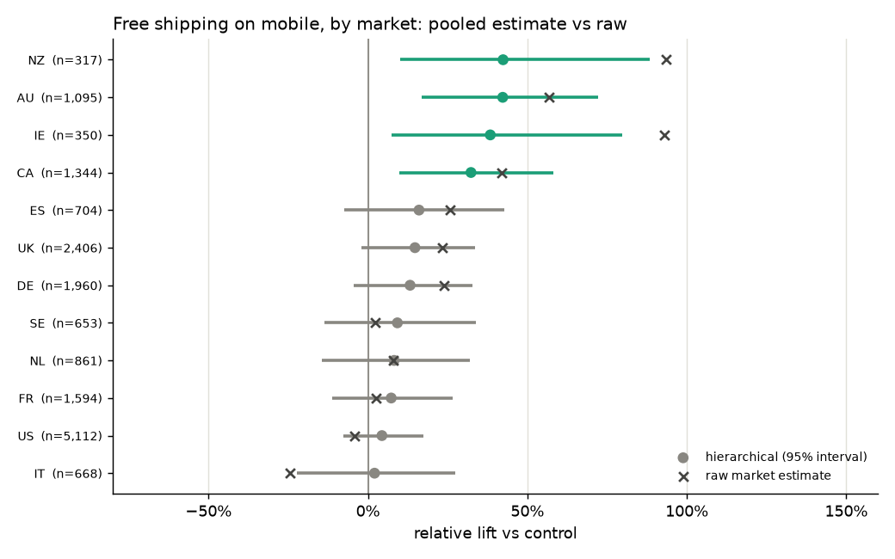
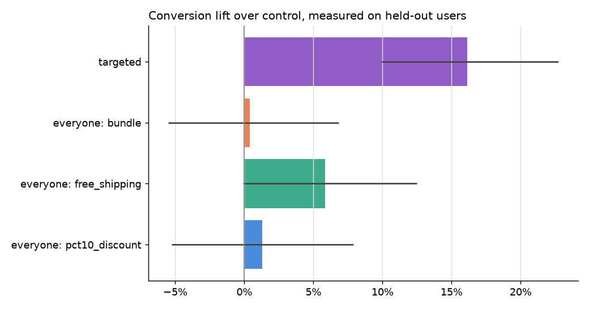
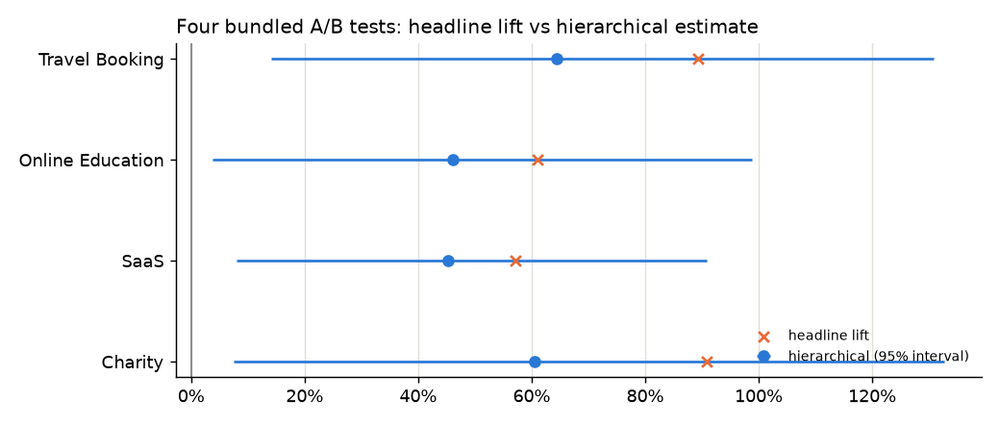
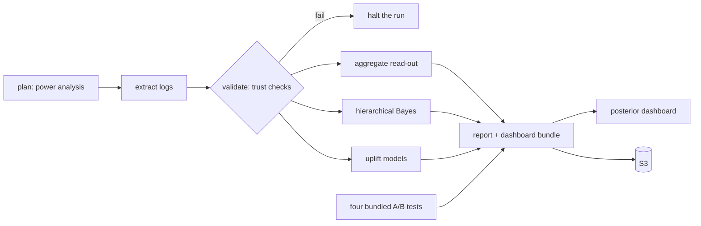

# Bayesian Experimentation & Uplift Modeling Platform


Decides whether an experiment's lift was real, finds which users respond to which
offer, and catches the ways an experiment quietly breaks before anyone reads the
result.

- **Hierarchical Bayesian treatment effects in PyMC.** Segment effects share
  strength across low-volume markets, devices and customer types. Priors, prior
  and posterior predictive checks, and credible intervals with a
  region-of-practical-equivalence rule decide whether a lift was real.
- **Uplift models for heterogeneous treatment effects.** These find which users
  are most likely to respond to each offer. Automated checks cover sample ratio
  mismatch, missing exposures, delayed conversions, leakage and contamination.
- **Planned before launch, reproducible after.** Power analysis runs before any
  data is read. Airflow pipelines run in Docker on AWS, and a dashboard of
  posterior effects serves product and engineering. On the offer test below,
  the platform surfaces incremental lift that aggregate A/B testing missed.

> Built on [Cyrus Namjoo's A/B Test Analyzer](docs/original_ab_analyzer.md)
> (MIT), whose session-level analysis of four website experiments is still here
> and still runs. The platform work described below was added on top of it.

## What it found

A four-arm offer test (control, 10% discount, free shipping, bundle) across 12
markets, 3 devices and new vs returning customers. It ran with 117,000 users,
which is the size the pre-launch power analysis asked for. The logs are
simulated with known true effects, so every estimate below can be checked
against the truth ([full readout](reports/platform/report.md)).

| Question | Aggregate A/B test | This platform |
| --- | --- | --- |
| Does any offer win? | No. Best is free shipping at +5.8%, Dunnett-adjusted p = 0.15 | Same overall: every offer's 95% interval includes zero |
| Who does the discount work for? | Not answerable | **+29%** for new customers (+17% to +42%), **-13%** for returning (-19% to -7%) |
| Does free shipping work anywhere? | Not answerable | **+32% to +42%** on mobile in AU, NZ, IE and CA, the far-shipping markets, two of them too small to test alone |
| What is targeting worth? | Not answerable | **+16.2% conversion** (+9.9% to +22.7%) on users the models never trained on, 81% of the oracle gain |



NZ and IE have about 330 users per arm in this view. Their raw lifts (+93%) are
mostly noise. Alone, the launch plan says a market that size could only detect a
+68% lift. The hierarchical model pulls those estimates toward what the related
segments support, and still finds them credibly positive. Against the true
effects, pooling cuts per-segment error from about 0.4 to 0.5 down to 0.05 to
0.11.



### On the four real A/B datasets

The bundled website tests all showed headline lifts of +57% to +91% from about
600 sessions per arm. The original analysis already warned these were inflated
(the winner's curse). Read hierarchically across device and user type, every
lift is still credibly positive, but smaller: +45% to +64%.



## How it works



| Stage | What it does | Module |
| --- | --- | --- |
| Launch plan | Users per arm for a 10% lift at 80% power across 3 offers with Dunnett's correction, runtime, per-segment detectable lift, Bayesian assurance, simulated power and family-wise error | `launch_plan.py` |
| Trust checks | SRM at assignment and exposure, assignment conflicts, missing exposures (and whether they differ by arm), contamination, conversion lag vs window and immature users, covariate balance, feature leakage | `integrity.py` |
| Aggregate read-out | Each offer vs control, Dunnett-adjusted, as the plan specified | `launch_plan.py` |
| Hierarchical model | Partially pooled market, device, tenure and pairwise interaction effects per offer, with non-centred PyMC model, prior and posterior predictive checks, R-hat, ESS, divergences, ROPE verdicts and prior sensitivity | `hierarchical.py` |
| Uplift | Cross-fitted gradient-boosted outcome model per arm, best-offer policy, inverse-propensity policy value with bootstrap intervals, Qini per offer | `offer_uplift.py` |
| Pipeline | Task graph with run manifests (config fingerprint, input hashes, versions, git commit, timings). Same config and seed give byte-identical outputs | `workflow.py` |
| Orchestration | Airflow DAG generated from the same task list, with each task in its own virtualenv | `airflow/dags/` |
| Dashboard | Posterior distributions, segment forest plots (raw vs pooled), targeting, diagnostics, run manifest | `app/posterior_dashboard.py` |
| Simulator | Event-level logs with known true effects and switchable defects | `simulate.py` |

The model, priors and checks are explained in the docstrings of `hierarchical.py`;
each design decision is in the commit history.

## Run it

```bash
python -m venv .venv && source .venv/bin/activate   # Windows: .venv\Scripts\activate
pip install -e ".[app,fast,dev]"

python -m pytest                                     # 80 tests
python -m abkit.workflow run --run-id demo --quick   # whole pipeline in about 2 minutes
python -m abkit.workflow run --run-id full           # 4 chains x 1,000 draws, about 7 minutes
python -m streamlit run app/posterior_dashboard.py   # dashboard for finished runs
```

Point it at real logs with `--source path/to/folder`, where the folder holds
`experiment.json`, `users.csv`, `assignments.csv`, `exposures.csv` and
`conversions.csv` (see `experiment_io.py`). If a trust check fails, the run stops
before anything is estimated.

### Airflow in Docker

```bash
mkdir -p artifacts && echo "AIRFLOW_UID=$(id -u)" > .env
docker compose up -d --build
# Airflow: http://localhost:8080 (admin / admin), dashboard: http://localhost:8501
```

The `abkit_experiment_readout` DAG runs daily. Trigger it with `{"quick": true}`
for a fast run. Set `ABKIT_S3_URI` in `.env` to publish each finished run to S3.

### AWS

`infra/aws/` has Terraform for one EC2 instance running the same compose stack,
plus:

- a versioned, encrypted S3 bucket for readouts
- the Airflow password in SSM Parameter Store
- Session Manager access instead of SSH
- ports open only to the CIDRs you list

See [infra/aws/README.md](infra/aws/README.md).

## Limits

- The offer test is simulated, so its effects were designed. That's what makes
  the estimates checkable, but it isn't evidence about a real business. The four
  bundled datasets are coursework data (see the [original README](docs/original_ab_analyzer.md)).
- Docker and AWS files are checked statically (compose structure, Dockerfile
  sources, `terraform validate`, a rendered and syntax-checked boot script) and
  the pipeline was run from a clean install the way the containers run it. They
  have not been run on Docker or AWS from this repository.
- Airflow can't run on Windows, so the DAG is tested against a stand-in Airflow
  module, and its command template was rendered with Jinja and run through the
  real CLI.
- Users are randomised once. Repeat exposure, interference between users and
  sequential monitoring of the Bayesian model are not modelled.

## Original toolkit

`python scripts/run_analysis.py` still runs Cyrus Namjoo's session-level
analysis of the four website tests. It covers trust checks, frequentist and
Beta-Binomial read-outs, guardrails, power and peeking simulations,
Holm-corrected segments and a T-learner, and writes `reports/summary.md`. His
Streamlit app is at `app/streamlit_app.py`, and his write-up is in
[docs/original_ab_analyzer.md](docs/original_ab_analyzer.md).

## References

- Gelman, A., & Hill, J. (2007). *Data Analysis Using Regression and Multilevel/Hierarchical Models*. Cambridge University Press.
- Gelman, A., & Carlin, J. (2014). Beyond power calculations: Type S and Type M errors. *Perspectives on Psychological Science, 9*(6), 641-651.
- Kruschke, J. K. (2018). Rejecting or accepting parameter values in Bayesian estimation. *Advances in Methods and Practices in Psychological Science, 1*(2), 270-280.
- Dunnett, C. W. (1955). A multiple comparison procedure for comparing several treatments with a control. *JASA, 50*(272), 1096-1121.
- Kohavi, R., Tang, D., & Xu, Y. (2020). *Trustworthy Online Controlled Experiments*. Cambridge University Press.
- Kunzel, S. R., Sekhon, J. S., Bickel, P. J., & Yu, B. (2019). Metalearners for estimating heterogeneous treatment effects using machine learning. *PNAS, 116*(10), 4156-4165.
- Radcliffe, N. J. (2007). Using control groups to target on predicted lift. *Direct Marketing Analytics Journal, 1*, 14-21.

## License

MIT. Original toolkit copyright Cyrus (Sirous) Namjoo; platform extensions
copyright Brandon Armstrong. See [LICENSE](LICENSE).
