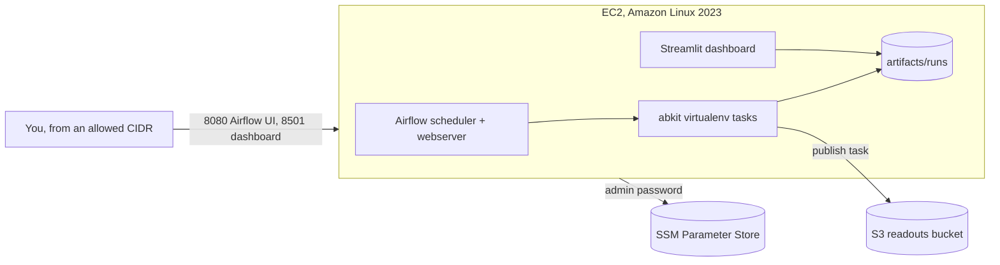

# Running the pipelines on AWS

One EC2 instance runs the same `docker compose` stack as a laptop does: Postgres,
the Airflow scheduler and webserver, and the posterior dashboard. Airflow runs the
`abkit_experiment_readout` DAG every day, and each finished run is copied to S3.



| Resource | Why |
| --- | --- |
| S3 bucket | Versioned, encrypted and private home for published readouts |
| SSM parameter | Generated Airflow admin password, never in user data or outputs |
| IAM role | Session Manager access, read and write on the bucket, read on that one parameter |
| Security group | Ports 8080 and 8501 only, from the CIDRs you list (`0.0.0.0/0` is rejected) |
| EC2 instance | `t3.xlarge` by default so four MCMC chains run in parallel; IMDSv2 only, encrypted disk |
| CloudWatch alarm | Recovers the instance if AWS's system status check fails |

## Deploy

```bash
cd infra/aws
cp terraform.tfvars.example terraform.tfvars   # set vpc_id, subnet_id, allowed_cidrs
terraform init
terraform apply
$(terraform output -raw admin_password_command)  # Airflow password for user "admin"
```

First boot takes a few minutes while the images build. Then open `airflow_url`,
trigger `abkit_experiment_readout` (optionally with `{"quick": true}`), and read
the result in `dashboard_url` or in the bucket under `readouts/<run date>/`.

`terraform output shell_command` opens a shell on the machine through Session
Manager. There is no SSH port.

## Limits

- The configuration passes `terraform validate` and its boot script was rendered
  and syntax-checked, but it has not been applied from this repository.
- One instance with LocalExecutor is right for a team's daily readouts. Heavier
  use would move to Amazon MWAA or Airflow on ECS with a managed Postgres.
